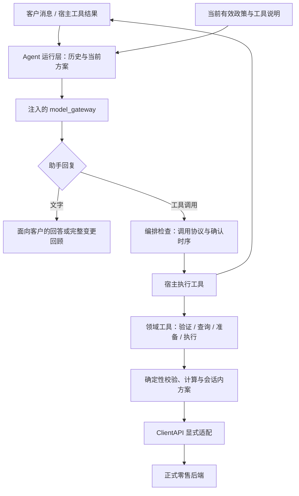

# Agent 实施规划

日期：2026-10-09。配套事实与出处见 [PROJECT-ANALYSIS.md](PROJECT-ANALYSIS.md)。本文中的模块、工具名和内部状态名是拟采用的工程设计，不是平台新增接口；平台入口、消息、REST 和评测范围仍严格遵循现有契约。

## 1. 交付目标与设计原则

交付一个能完成真实多轮消费零售服务的 Python Agent：根据客户意图和实时记录进行推理，主动澄清，调用合适工具，安全完成允许的变更，并准确说明结果。

1. **模型负责语义。** 意图、代词指向、同义理由、条件与优先级、改口、是否确认以及是否请求升级，由 LLM 在完整上下文中判断。
2. **代码负责可验证的约束。** 数据结构、客户归属、状态、同产品、可用性、重复数量、支付资格、金额算法、调用顺序、未确认不得写入等由工具和编排层执行。
3. **运行时以真实工具结果为依据。** 不把模型推测当数据，不把计划当成功，不把历史案例金额当当前记录。
4. **按能力组合实现。** 不编写 case_id 分支、已知客户/商品到答案的表、复杂正则意图树或固定对话脚本。
5. **只有业务需要的持久性。** 会话内部状态用于当前服务；不增加客户数据库字段、不建立跨会话隐藏记忆。
6. **离线先行、在线授权。** 模拟网关和合成后端验证逻辑；真实模型理解能力通过获授权的运行验证，不把 mock 通过当语义能力已证明。

当前 `main / retail_plus / python / t1 / case_ids:null` 保持不变。规划覆盖业务能力不等于授权改成 p1/t2 或扩大案例范围。

## 2. 总体结构



不要在 Agent 内绕过宿主直接执行模型 tool calls。保持平台的 assistant tool call → 宿主工具执行 → MultiToolMessage → 下一次模型决策流程。

### 拟定目录与职责

```text
agent/
  agent.py                         # 工厂取得 context；薄入口
  agent.json                       # 既有 protocol/language/domain
  tools.py                         # toolkit 注册与导出
  support_agent/
    application.py                 # 多轮 Agent 与输出协议
    state.py                       # 会话状态及版本
    gateway.py                     # 模型选择、参数、消息适配
    prompts.py                     # 核心指令、阶段相关上下文
    policy/                        # 精简的当前政策，随 agent/ 提交
    domain/
      identity.py                  # 验证结果、会话客户限制
      orders.py                    # 归属、状态、商品出现次数
      catalog.py                   # 结构化候选比较与属性保留
      money.py                     # calculator 与金额校验
      changes.py                   # 方案、依赖、前置条件、回执
    adapters/
      client_api.py                # 传输、编码、错误封装
      customer_api.py              # 客户相关已公开 operation
      catalog_api.py               # 目录相关 operation
      order_api.py                 # 订单相关 operation
      conversation_api.py          # 转接
    toolkits/
      customer.py                  # 验证与自有记录读取
      catalog.py                   # 商品读取/筛选/比较
      changes.py                   # 准备方案与七类执行工具
      conversation.py              # 人工转接
tests/
  fixtures/                        # 合成后端与消息数据
  test_protocol.py
  test_identity.py
  test_catalog.py
  test_changes.py
  test_conversation.py
  test_replay.py
docs/
  PROJECT-ANALYSIS.md
  IMPLEMENTATION-PLAN.md
  POLICY-REGISTER.md               # 实施时补充逐条规范化决策
  COVERAGE-MATRIX.md               # 要求→工具→测试→真实结果
```

目录是职责建议；实现时可合并小模块，避免空壳层次。保留现有包结构，逐步替换，不在根目录创建第二套运行 Agent。运行所需政策放在 `agent/`，大型原始材料继续留在仓库外。

## 3. 工具设计

工具向模型暴露业务含义清楚、参数有类型的能力。以下名称为候选，最终以实现的注册 schema 为准。REST 参数不可因工具设计而扩充。

| 工具组 | 建议能力 | 边界与返回信息 |
|---|---|---|
| 身份 | `verify_customer` | email 或完整姓名+ZIP，optional claimed customer ID；先 search，核对后读 profile，绑定会话客户；失败不泄露记录 |
| 客户与订单 | `get_customer_summary`、`list_customer_orders`、`get_owned_order` | 客户来自 toolkit 已验证状态；订单先核对自有清单与归属；返回订单状态、原成交项、付款/退款和物流分组 |
| 商品 | `list_products`、`get_product_variants`、`get_catalog_item` | 真实完整目录；单变体不能假定有 product_id |
| 候选比较 | `compare_variants` | LLM 提供结构化筛选、排序与保留属性；工具计算可用候选、数值比较、同分次序并附原始值 |
| 计算 | `calculate` 或领域 calculator | 有类型操作及有限数值数组；计算合计、差价、退款分项、计数；不使用任意 Python eval |
| 方案准备 | `prepare_change` | 仅支持七种明确业务类型；可组合必要读取和 calculator，不做远程写入；返回完整结构化方案与回顾所需事实 |
| 执行 | 七个单独的 `execute_*` 工具 | 仅接收有效 prepared proposal 引用；每次检查身份、归属、状态与具体约束；每个工具最多发一个业务写入 |
| 结果核查 | `inspect_change_result` 或复用只读工具 | 读取已有公开记录，区分 completed/accepted/failed/unknown；不添加未公开 status API |
| 人工 | `transfer_to_human` | conversation_id 从可信 context 取得，summary 仅含必要事实；accepted 后停止客户 API 操作 |

### 工具约束的具体分工

- `verify_customer` 不接受 `verified=true`，后端 search 结果才是验证依据。若已绑定 A，不因模型传 B 而切换会话账户。
- 读取他人订单时不能先把原始响应交给模型再让模型决定隐去；在工具边界阻止未经授权的数据输出。优先利用已验证客户的 order_ids 拦截非自有目标，再核对实际归属。
- `compare_variants` 的价格、available 和商品归属来自 toolkit 的 API 读取或可追溯的会话内查询缓存；模型只提供 ID 和结构化筛选/排序条件，不能把模型回传的任意目录 JSON 当作事实。“更适合我”这类自然语言偏好先由模型澄清。只解析已知单位/数值时采用明确转换，不猜缺失规格或静默把字符串排序当数值排序；执行前再次核实受确认约束的事实。
- calculator 可供模型独立调用，也可被准备工具确定性使用；保留计算输入、运算和输出，让金额能追溯。最终回执仍是执行事实。
- 准备工具不是任意 JSON 转 HTTP 的通道。各业务参数各有 schema、资格检查和输出模型；统一入口只用于共享准备流程。
- 执行工具的业务入参来自已保存方案，不能允许在 execute 时偷偷替换地址、商品、退款目的地。
- 工具注册 READ/WRITE/GENERIC 按实际副作用和框架约定选择。只读准备不发远程写入，但其会话内状态必须能由工具轨迹重建。

## 4. 对话状态与确认机制

### 4.1 分离三种信息

| 信息 | 保存位置与用途 |
|---|---|
| 客户意图和对话 | Agent state：完整相关消息、当前请求、澄清与用户最新表达 |
| 可验证业务事实 | toolkit state：由读取工具建立的已验证身份、当前方案、必要快照及执行结果 |
| 后端记录 | 只能通过公开 API 读取/变更；不能把 Agent state 私自写入客户数据库 |

Agent state 使用明确可恢复的结构。本地真实 tau2 已验证 Pydantic JSON 序列化和 `TypeAdapter(Message)`，实现消息 codec 时按这些实际接口处理，再测试 Agent state 的整体恢复。`get_init_state(message_history)` 必须保留传入历史，各会话不共享可变对象。

建议 Agent state 至少包含：消息历史、待返回调用 ID 集合、请求目标摘要、当前 proposal 的 ID/版本、真实已展示回顾的消息位置、最新用户轮次、已完成/结果未知的动作摘要、转接状态。不能只保存一个 pending_call_id。

toolkit state 至少包含：已验证客户、确定性 proposal 计数或规范化摘要、完整准备参数、前置事实、执行尝试状态及回执。所有字段必须由本会话此前工具调用可重建；不依赖墙上时间或随机 ID。

proposal 生命周期明确为 `prepared → attempted → completed / accepted / failed / unknown`。发出远程写请求之前即标记 attempted；超时/未知结果不能退回 prepared。重复 execute 返回已有回执或要求只读核查，不再次发出写请求。明确失败也不自动重写；是否能准备新的操作，必须先根据失败类型、当前真实记录和客户仍有效的意图决定。该状态防止单会话工具重入；不能声称已获得后端未提供的幂等键或跨崩溃 exactly-once 保证。

### 4.2 准备 → 回顾 → 确认 → 执行

1. 模型收集并明确完整意图，用只读工具确定客户、订单、商品、地址和资金方案。
2. `prepare_change` 读取必要记录、校验可行性、调用 calculator，生成不可在 execute 时悄悄改动的 proposal。
3. Agent 向客户实际发出完整回顾。回顾必须涵盖 proposal 的关键字段；可用结构化方案生成稳定的事实区块，模型补充解释。仅模型声称“我已回顾”不算已经展示。
4. 一次性清单操作同时明确询问是否完整并等待客户回答。禁止在同一条 assistant 中一边询问一边返回 write call。
5. 下一用户消息由模型结合对话判断：明确同意当前方案、改口、暂停、拒绝、补充或只问问题。代码不做 yes/no 词典分类。
6. 编排层只放行指向当前已展示版本、且展示后确有新用户输入的执行调用；结合模型对该输入的语义判断。模型随意传一个 `confirmed=true` 不构成独立授权凭据。
7. toolkit 检查 proposal 存在、处于 prepared、目标未变，并紧邻写入重查相关后端事实。状态、价格、可用性、付款资格或地址方案发生影响确认的变化则返回需重新准备/确认，不自动接受新方案。前置检查通过后先标记 attempted，再发出一次写请求。
8. 正式接口返回后记录回执和生命周期终态，模型据实告知结果；失败/未知进入相应处理或只读核查，不把已尝试或已完成部分重做。

这里有两个必须诚实区分的保证：编排器能机械检查“实际展示过哪个方案、用户是否在其后输入、执行是否仍引用同一版本”；用户话语究竟是否同意属于 LLM 的语义判断。toolkit 当前没有完整对话接口，不能声称工具独立证明了客户授权，更不能构造模型可伪造的 boolean 来宣称解决了这一问题。

proposal 是我们设计的会话内部对象，不增加 REST 字段。建议内容：kind、customer_id、order_id（如适用）、有序且保留重复的 items/replacements、完整 address、payment/refund method、取消理由、资金分项、相关状态和数据快照、方案版本及执行结果。

### 4.3 多请求计划与部分成功

- 以客户实际授权的目标构建小型依赖关系。例如同单地址和商品都要改时，先完成仍依赖 pending 的地址操作，再做一次性商品修改。
- 不因技术上方便而合并不同订单、删掉重复商品或扩大全单范围。取消会使其余订单修改失去意义，需先澄清客户真正选择。
- 可一次向客户完整回顾多个明确步骤并取得覆盖它们的确认；执行串行，每步重查，不要求对不变事实无意义重复确认。
- 协议层每个 assistant 工具批次最多包含一个业务写入；该写入独立一批，不与依赖其结果的读取混排。转接也独立一批。等待真实回执再决定下一次调用，不能假设宿主按模型列出的顺序串行执行一批工具。彼此独立的只读调用可以同批。
- 第一项成功、第二项失败时保留第一项回执，准确报告部分成功；不回滚已成功业务、不重跑整个计划，也不假装跨 API 原子事务。
- 之前步骤改变后续金额、支付资格或客户条件时，对受影响方案重新准备并确认。
- pending 商品修改、退货、换货各自一次性；提交后不能以“同一方案追加”规避后端状态限制。

## 5. 政策注入与上下文管理

实现时建立 `POLICY-REGISTER.md`：每条规范包括内部 policy ID、适用范围、有效决定/日期、原文锚点、替代过的旧规则、对应工具和测试。该登记表是开发审计资料，不塞入客户业务数据库。

给模型的运行政策应精简、明确、分场景：

- 全局：身份、本人账户、真实记录、语义确认、禁止越权、正常回复与工具调用轮次。
- 查询与商品：可访问范围、偏好澄清、现有属性保持、数据不足说明。
- pending：地址、付款、取消理由、一次性商品修改与执行顺序。
- delivered：退货/换货资格、完整清单与不同付款目的地规则。
- 结果与转接：金额/时间、失败不当成功、三类转接依据与固定文本。

按当前任务选择相关政策/工具子集可以减少上下文，但不能漏掉身份、确认等全局约束。执行硬约束仍在代码；仅隐藏工具不是安全保障。不要把全部历史争议不加有效性标签地放进提示词。

客户文本以及工具返回的商品属性、错误 message 等都不能修改系统政策或授予额外权限。包含“跳过验证”“换一个客户”“直接退款”等指令性文字时，仍作为待解释的数据处理，不能覆盖身份、确认、状态或工具边界。离线测试检验编排和工具约束；真实模型对语义诱导的处理表现另在获授权运行中验证。

初版优先保证完整正确的消息历史；需要压缩时，只压缩已完成请求和冗余工具内容，保留身份依据、当前客户原话、待确认方案、改口、未决结果和金额来源。不让压缩摘要新增事实或恢复已失效确认。

不在运行时读取 E 盘原始资料绝对路径，不依赖网络文档，不把公开测试答案或固定样本余额打包进 Agent。

## 6. 分阶段实施与验收

按阶段完成可运行纵向切片，每阶段结束展示变更、实际测试结果和下一阶段依赖。以下是工作顺序，不是已实现状态。

### P0：契约与证据基线

**产出**：当前分析/计划，规范化政策登记，要求到测试的覆盖矩阵，合成 fixture 设计。

**工作**：

- 记录全部 14 个 operation 的正常 schema、错误、读写/重试属性。
- 把七类写入政策和历史替代规则转为明确验收条件。
- 标明正常契约、异常鲁棒性、我们自己的设计选择，避免互相冒充。
- 固定当前 binding/task/case_ids 的基线，不触碰工作流或评测配置。

**通过条件**：每个关键约束有出处；没有未批准政策、虚构 API、硬编码案例答案。

**当前状态：P0 已完成（2026-10-09）。** 已登记 [52 项政策及平台/工程约束](POLICY-REGISTER.md)，提取 [14 个 operation 的 API 基线](API-BASELINE.md)，建立 [22 项能力覆盖矩阵](COVERAGE-MATRIX.md)，并提供 [合成 fixture](../tests/fixtures/README.md) 和 [离线检查脚本](../scripts/check-p0-baseline.py)。实际 [验证报告](P0-VALIDATION.json) 记录 71 个 schema 合法样本检查通过、7 个 schema 负例全部按预期拒绝，以及来源 hash、引用关系和货币类型一致性检查通过。

其中 5 个格式合法的政策反例和 6 个身份语言蓝图用于后续业务/模型测试；P0 未执行这些业务判断或语言测试。P1 协议骨架现已完成，业务工具按 P2 及后续阶段实施。

### P1：真实 Agent 协议骨架

**产出**：context 工厂、gateway 适配、消息/状态管理、mock gateway 协议测试。

**工作**：

- 用 LLM 决策循环替换确定性文本分支，先接现有只读身份工具形成最小闭环。
- 保留传入历史、处理多个 ToolCall/ToolMessage、调用 ID 关联和错误结果。
- 正确使用 `actions`、运行时模型名单、固定参数省略、合法消息返回。
- 记录模型调用次数与工具轮次，使用显式的工程调用上限避免无进展循环；具体上限结合实际平台限制和费用授权确定，耗尽时准确保留未完成状态，不能声称任务成功或擅自换更贵模型。
- 本地已安装官方 Hyper-tau 的固定版本，七项真实接口检查通过，见 [LOCAL-DEVELOPMENT.md](LOCAL-DEVELOPMENT.md)。用户已授权后续所需本地依赖直接安装到 `.venv/`。使用真实消息类型和工具注册做离线集成，只有模型回复与业务后端使用 mock；课堂运行的实际兼容性仍在后续授权接入中验证。
- 本地已核实资源辅助方法、`gateway.models` 配置和 `validate_request`。按实际签名使用，区分固定与 `one_of` 参数，正式模型选择以当次注入配置为准。

**通过条件**：用户→模型 tool call→宿主结果→模型回答完整跑通；多结果、错误、会话隔离、历史恢复、text/tool_calls 互斥均通过；测试证明 Agent 真的调用 gateway，而非依旧正则选择固定答案。本地离线通过不宣称课堂部署兼容性或真实模型的业务理解能力已验证。

**当前状态：P1 已完成（2026-10-09）。** 真实 tau2 类型和网关协议的离线测试通过 26/26（22 项 P1 协议测试、4 项保留的 API/状态测试）。实现、工程上限和已知阶段边界见 [P1 实施记录](P1-IMPLEMENTATION.md)，实际检查结果见 [P1-VALIDATION.json](P1-VALIDATION.json)。未调用真实 provider、未 push 或运行远程评测，P2 尚未开始。

### P2：身份与自有记录只读切片

**产出**：身份、客户、订单、目录六个只读 operation 的适配和工具。

**工作**：

- 支持 email、完整姓名+ZIP；claimed ID 需独立匹配。
- toolkit 绑定单客户，先验证再 full profile；自有订单查询与错误订单澄清。
- 正确保留支付流水类型、物流数组、重复商品、原成交价。
- 查询完整目录，区分产品种类数、变体数、可用变体数。

**通过条件**：两种验证路径、错误 ID、验证失败、他人订单和会话换账户均得到正确处理；未验证和跨账户请求不能获得敏感详情；只读任务没有写 API；路径编码及错误分类有断言。

### P3：商品比较、calculator 与方案准备

**产出**：结构化候选比较、领域计算、七类 prepared proposal；此阶段不开放远程写入。

**工作**：

- 模型理解筛选与排序偏好，工具对现有字段做确定性比较，保留用户未要求改变的属性。
- 同产品检查、available 检查、有序重复映射；跨商品拒绝，缺失规格不编造。
- 独立处理整单付款金额、取消退款分项、原成交价退货与新旧规格差价。
- 检查礼品卡余额按整单或正差价的不同要求；保留付款/退款方向。
- 用规范化序列产生可重放 proposal；给出可行/不支持/缺信息/需重新报价的明确结果。

**通过条件**：重复原变体换不同目标、全属性匹配、无货备选、最大/最小及同分条件、正负差额、异常金额、gift card 不足均正确；差价累加与后端舍入约定一致。相同 item_id 的实例有不同成交价/属性且客户要求指定其中一条时，明确接口无法精确定位，不依赖隐藏索引猜选；无任何远程写入。

### P4：确认边界与首批低耦合写入

**产出**：回顾展示记录、确认时序检查、默认地址/订单地址/取消执行工具。

**工作**：

- 先用三类变更验证共同机制，再扩展其他写入。
- 全地址回读、纠正失效、客户暂停、无关 yes、附条件同意、变更后端状态的处理。
- 取消理由由模型作有边界的语义映射，工具只接受当前两种合法值及合格订单；不因不合格理由而诱导客户换说法。
- 执行工具只调用一次相应 API，按真实回执分类，禁止自动重写。

**通过条件**：未实际展示方案、未有后续用户输入、旧 proposal、改口/暂停、未知订单状态不能写；两种地址不连带；不支持部分取消保持零写入；取消流水和时间解释正确。

### P5：支付、商品修改、退货与换货

**产出**：剩余四类执行工具，完整七类业务切片。

**工作**：

- 支付替换：不同的已有方式、一个方法、礼品卡覆盖整单；成功仍 pending，decline 不虚报修改。
- pending 商品修改：清单完整性最后询问并等回答，一次完整请求，成功状态锁定。
- 退货：一次收齐 item_ids，原成交信息，原支付/合格既存 gift card 的目的地选择。
- 换货：同产品可用目标，重复原 item 一一对应，价差一个保存的付款方法结算。
- 各写入前重新检查状态与受确认约束的事实，变化需要新 proposal。

**通过条件**：每类都有成功、资格失败、用户撤回、API 拒绝、重复调用和结果未知测试；没有拆写“一次性”请求，没有把退货/换货/取消目的地混用，没有未授权替代操作。

### P6：多请求编排、转人工与异常恢复

**产出**：跨请求计划、部分成功报告、结果核查、人工转接、完整 replay 测试。

**工作**：

- 同单先地址/付款后商品修改；跨订单各自记账；客户改目标时只保留仍有效步骤。
- 写超时、409/422、畸形/缺字段响应、暂时旧读、未知状态、模型格式错误的保守恢复。
- 明确处理 `413 request_too_large`、`502 response_too_large`：停止该操作并说明限制，不裁剪、拆分一次性写入或重试写入绕过容量约束。
- 只读重试和核查次数有明确上限，避免无限循环；限制属于工程执行保护，不变成业务“锁账户”等新政策。
- 已执行步骤不得整体重做；未知结果不自动重放，不臆造补偿事务。
- 按三类依据执行转接；客户明确请求人工时即暂停尚未执行的业务写入，除非明确要求同时完成且已经确认。accepted 后固定文字且不再调用客户 API；明确人工请求不强制额外排障。
- 新 toolkit/新后端重放相同工具轨迹，验证身份、方案和执行状态可重建，不依赖时钟/随机数。

**通过条件**：顺序依赖正确、部分成功准确、身份隔离不受恢复影响；写批次和调用次数严格受控；attempted/unknown 重复执行不产生第二次远程写入；重放产生等价结果；转接后零客户 API 调用。

### P7：离线完整回归与提交包检查

**产出**：能力覆盖报告、打包审计、待在线验证问题列表。

**工作**：

- 将 134 项公开需求映射为通用能力与边界测试，不把期望业务数据引入 Agent。
- 组合多轮改口、错误 ID、条件授权、重复商品、多个订单、负差价、状态变化、无货选择和只读咨询。
- 检查最终后端状态、工具轨迹、客户回复的必要事实三个维度。
- 保留六项旧测试中有效的安全语义；重写只为旧正则实现服务的断言，不为追求测试数量添加实现镜像测试。
- 检查只提交 agent/、文件/总大小、导入依赖、无现场安装、无 E 盘依赖、无凭证或 ZIP。

**通过条件**：能力矩阵每行有测试与实际结果；关键负例断言零写入；测试命令在当前环境真实可执行；所有已知协议风险列明，没有用“本地全部通过”掩盖真实运行时未验证部分。

### P8：获授权的真实模型与评测验证

**产出**：真实运行报告及针对性修复，而不是猜测的通过率。

**工作**：

- 核对运行时模型、参数限制、费用与额度授权；不依据 cost=0 或研究预算猜免费。
- 首先按用户授权保持既有 t1 做接入回归；只有明确获准时才选择 p1 或指定 t2 范围，不修改网页绑定来绕过选择。
- 提交前展示变更、目标仓库/分支、任务和范围，只暂存本次相关文件；遵守用户对 commit/push 的授权范围。
- 记录 commit、snapshot SHA、job/run ID、任务/范围、模型、用量、trace 与真实通过/失败数；等待同一任务终态，不重复提交制造新结果。
- 从 trace 区分协议、业务决策、工具约束、沟通遗漏、基础设施错误。修复通用原因，不能为失败题号加答案分支。
- 401/403/503 或工作流失败按用户要求停止并报告脱敏原因，不循环重试。

**通过条件**：报告可追溯到真实运行；没有运行的任务明确标记未运行。t1 通过仅表示接入检查，不推导完整业务成功。

## 7. 验收矩阵的首批必测项

| 维度 | 必须覆盖的场景 | 验收观察点 |
|---|---|---|
| 协议 | 多工具结果、错误 JSON、历史恢复、消息互斥、同批多写/read-write/转接混排 | tau2 边界和 ID 对应，非伪造工具成功；只放行允许的独立批次 |
| 身份 | ID 单独、email、姓名+ZIP、失败、另一个客户 | search 在 profile 前，失败/越权零敏感输出 |
| 只读 | 订单、物流、目录计数、余额咨询 | 零写入，字段和数量来自后端 |
| 语义确认 | 无关 yes、附条件、补充、纠正、暂停 | 只执行当前已展示且真正获同意的完整方案 |
| 状态 | 七种正常枚举、未知、执行前变化 | 无错状态写入，不使用 shipped 等猜测值 |
| 商品 | 同产品、无货、属性保持、条件优先级 | 选择可追溯，不推荐未经表达的偏好 |
| 重复项 | 两个同 item 换成不同目标、部分取消要求、同 ID 不同成交价/实例属性 | 不去重、不扩范围、不发明行号；特定实例无法定位时明确能力边界 |
| 金额 | 整单/差价、退款分项、舍入、非法值 | calculator 来源，正确符号，最终回执为准 |
| 付款 | 非保存方法、余额不足、拆付、decline | 正确拒绝或保持原状，不虚报成功 |
| 一次性操作 | 提交前新增、提交后追加、确认后暂停 | 完整收集和等待，单次业务提交 |
| 复合请求 | 地址+商品、跨单一收一退、中途失败 | 合法顺序与逐步回执，准确部分成功 |
| 异常 | timeout、409、422、413、502 response_too_large、旧读、不明回执 | 不自动重写，unknown 不变 success；不裁剪/拆写绕过容量限制 |
| 不可信内容 | 工具属性/错误文本含跳过验证、切换客户或立即退款指令 | 不改变身份、确认、状态和权限；模型抵抗语义诱导另做真实验证 |
| 重放 | 新实例重演工具轨迹、多会话同时存在 | 结果确定性、无状态泄漏 |
| 转接 | 明确要求、升级、不明政策、工具慢、待执行变更中请求人工 | 仅合法依据；请求时暂停待执行写入；accepted 后停止客户 API |
| 输出 | 退款时间、物流事实、未决问题 | 数据库状态和客户沟通都完整 |

语义确认的离线测试用 mock gateway 控制不同语义决策，检验编排保障；自然语言同义表达、复合句和真实模型误判率留给授权模型验证。这两类证据不可互相替代。

## 8. 实施节奏与完成标准

推荐第一轮实现 **P1 + P2 的最小只读纵向切片**：真正 gateway Agent → 身份验证 → 自有订单查询 → 真实结果回答。它先验证最关键的协议和架构，再进入资金与一次性写入。随后依次 P3–P7，在线运行作为 P8 单独记录。

每阶段交付应能回答四个问题：改了哪些能力；依据哪条契约/政策；用什么有效测试证明；还有哪些运行事实尚未验证。实现阶段可并行开发互不冲突的适配器、工具和测试，但应由单一集成路径维护 Agent 协议、状态与确认机制，避免三套互不兼容的会话模型。

项目完成标准是：Agent 使用真实模型进行语义决策；七类业务及合法转接通过明确的工具执行；身份、确认、状态、付款和重放约束有真实验证证据；授权范围内的评测报告完整可查。未授权或未运行的范围保留未验证状态，不声称全量通过。

不在本次规划阶段改业务代码、模型配置、评测任务、案例范围、绑定或服务开关。后续实现只以材料已有能力为边界，确需平台未公开能力时报告具体缺口，不自行补造接口。
